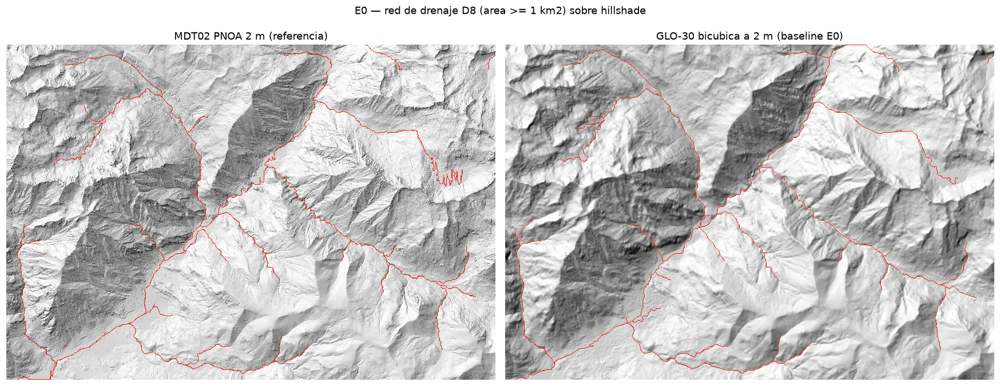

# E0 — Números de referencia de la bicúbica (GLO-30 → 2 m vs PNOA MDT02)

> **Ejecutado:** 2026-07-07 · pipeline completo en ~40 s · `uv run python e0/run_e0.py` (cwd `tfg/`)
> **Propósito (informe §7):** validar la instrumentación de evaluación y fijar los números que cualquier método de amplificación debe batir.

## Datos

| Rol | Dataset | Detalle |
|---|---|---|
| Entrada (LR) | Copernicus GLO-30 | Tile `N42_00_E000_00` del bucket AWS `copernicus-dem-30m` (Last-Modified 2022-05) — **edición previa al relleno de alta resolución 2023_1 en Pirineos**, así que no hay contaminación del experimento |
| Referencia (HR) | PNOA MDT02 2ª cobertura | `MDT02-ETRS89-HU31-0180-1-COB2.TIF` (CNIG, COG, 2021), hoja MTN50 180-1 |
| Zona | Benasque / macizo de Posets | 13.6 × 9.3 km, EPSG:25831, 6820×4669 celdas a 2 m, pendiente media 31.3° |

**Método baseline:** reproyección + remuestreo bicúbico (rasterio/GDAL `Resampling.cubic`) del GLO-30 directamente a la malla 2 m del MDT02. Red de drenaje con WhiteboxTools: fill depressions → D8 → flow accumulation → cauces con área ≥ 1 km² → Strahler. **Mismo pipeline y mismo umbral para referencia y predicción.**

## Resultados (los números a batir)

**Elevación** (n = 31.8 M celdas):

| Métrica | Valor |
|---|---|
| ME (sesgo) | **+2.01 m** |
| RMSE | **8.39 m** |
| RMSE centrado (sin sesgo) | 8.14 m |
| MAE | 4.62 m |
| NMAD | **3.16 m** |
| LE90 / LE95 | 11.45 / 16.23 m |

**Derivados:**

| Métrica | Valor |
|---|---|
| RMSE pendiente | **9.17°** |
| ME pendiente | **−2.00°** (la bicúbica aplana sistemáticamente) |
| Pendiente media ref / pred | 31.30° / 29.30° |
| RMSE aspecto (slope > 5°) | 28.01° |

**Hidrología** (área ≥ 1 km², densidad relativa de red 0.87; re-baselinado 2026-07-07 con WhiteboxTools a **1 hilo** — el multihilo resolvía empates de flujo en orden no determinista y el F1 bailaba en el 3er decimal):

| Tolerancia | Precisión | Recall | **F1** |
|---|---|---|---|
| 10 m | 0.555 | 0.497 | **0.524** |
| 30 m | 0.835 | 0.789 | **0.811** |
| 60 m | 0.895 | 0.868 | **0.882** |

**Strahler** (celdas por orden):

| Orden | Referencia | Bicúbica |
|---|---|---|
| 1 | 17 991 | 14 748 |
| 2 | 12 561 | 12 555 |
| 3 | 4 131 | 5 810 |
| 4 | **3 888** | **1** |

## Lectura

1. **La cola del error es pesada:** RMSE 8.39 m vs NMAD 3.16 m — el RMSE lo dominan outliers en el terreno escarpado (justo la limitación de RMSE que documenta la literatura; por eso reportamos ambos). El sesgo +2 m es consistente con geoide + residuo DSM/DTM, pequeño porque la zona es mayormente roca alpina.
2. **La bicúbica aplana:** −2° de pendiente media sistemáticos. Esto es lo que la amplificación con LEM debe restituir con relieve *plausible y bien colocado*, no con ruido.
3. **El hueco del TFG está en la tolerancia fina:** la red de la bicúbica es "correcta de lejos" (F1 0.89 a 60 m) y **mediocre de cerca (F1 0.52 a 10 m)**. Un método que ancle la red y genere el detalle con física debería subir el F1@10 m sin perder el resto — esa es la gráfica central del TFG.
4. **Fallo estructural interpretable:** la red de referencia alcanza orden 4 de Strahler; en la bicúbica el orden 4 prácticamente desaparece (1 celda) — la topología de confluencias del cauce principal se rompe. Métrica barata y muy contable ante un tribunal.
5. Caveats: D8 sobre llanos rellenados produce zigzags locales (visible en el lago/embalse del visual); tile recortado ⇒ efectos de borde en flow accumulation iguales para ambos; una sola zona (E5 añadirá más).



## Reproducir

```powershell
cd tfg
uv sync
# GLO-30 (AWS Open Data, sin registro):
curl.exe -s https://copernicus-dem-30m.s3.amazonaws.com/Copernicus_DSM_COG_10_N42_00_E000_00_DEM/Copernicus_DSM_COG_10_N42_00_E000_00_DEM.tif -o e0/data/GLO30_N42_E000.tif
# MDT02 (CNIG): flujo initDescargaDir -> descargaDir con el secuencial del fichero.
# Secuenciales hoja 0180 (ETRS89-HU31, COB2): 1->11340543  2->10324343  3->11340544  4->10324279
curl.exe -s "https://centrodedescargas.cnig.es/CentroDescargas/initDescargaDir?secuencial=11340543"
curl.exe -s -L --data "secDescDirLA=11340543" "https://centrodedescargas.cnig.es/CentroDescargas/descargaDir" -o e0/data/MDT02-ETRS89-HU31-0180-1-COB2.tif
uv run python e0/run_e0.py
```

Salidas: `e0/out/resultados-e0.json` (números), `e0/out/verificacion-visual.png` (hillshade + redes), rasters intermedios en `e0/out/*.tif` (no versionados).
